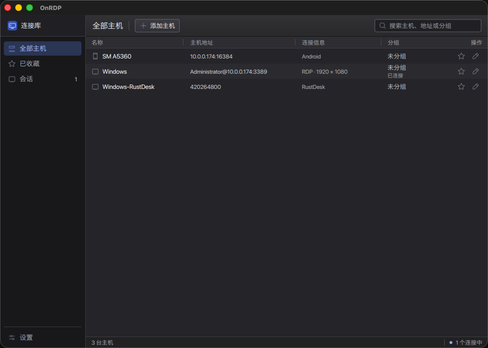

# OnRDP

**English** · [简体中文](README.zh-CN.md)

**Native remote desktop client · No Electron · No WebView**

Manage **RDP remote desktops**, **RustDesk connections**, and **Android screen mirroring and control** in one app on Windows, macOS, and Linux. Onix renders the interface natively, and FreeRDP handles RDP connections.

**[Download OnRDP](https://github.com/diiyw/onrdp/releases/latest)** · [Installation](#installation) · [Connection guide](#add-your-first-host)

If OnRDP is useful to you, consider giving it a **Star** on GitHub.



## Installation

Open the latest release and choose the installer for your system under **Assets**. [GitHub Releases](https://github.com/diiyw/onrdp/releases/latest)

| Your system | Installer | How to install |
| --- | --- | --- |
| Windows (64-bit) | `onrdp-windows-amd64-setup.exe` | Run the installer |
| macOS (Apple silicon) | `OnRDP-macos-arm64.dmg` | Open the disk image and drag OnRDP to Applications |
| macOS (Intel) | `OnRDP-macos-amd64.dmg` | Open the disk image and drag OnRDP to Applications |
| Ubuntu 24.04 / Linux Mint 22 (64-bit) | `onrdp-linux-amd64.deb` | Run the commands below from your download folder |

```sh
sudo apt update
sudo apt install ./onrdp-linux-amd64.deb
```

Use the release's `SHA256SUMS` file to verify your download. The macOS app is ad-hoc signed and has yet to be notarized by Apple.

If your installer is missing from the release, sign in to GitHub and check **Artifacts** on a successful build, or build OnRDP from source. [Installer builds](https://github.com/diiyw/onrdp/actions/workflows/build.yml) · [Development guide (Simplified Chinese)](docs/development.md)

## Add your first host

1. In OnRDP, go to **All hosts**, click **Add host**, and select **RDP**, **RustDesk**, or **Android**.
2. Give the host a name and enter the connection details below. You can also assign it to a group.
3. Click **Save**, then click the newly added host in the list to connect.

### Connect to Windows with RDP

1. On the remote PC, turn on Remote Desktop under **Settings → System → Remote Desktop** and make sure your Windows account has permission to connect. Windows Home supports outgoing RDP connections only. [Microsoft's Remote Desktop setup guide](https://learn.microsoft.com/windows-server/remote/remote-desktop-services/remotepc/remote-desktop-allow-access)
2. In the OnRDP **RDP** form, enter the PC's IP address or domain name and the Remote Desktop port (default `3389`).
3. Enter your Windows username and password. Fill in **Domain** if you use a domain account.

RDP uses TLS and Network Level Authentication (NLA). OnRDP currently skips server certificate verification. Connect only to trusted hosts on trusted networks.

### Connect with RustDesk

1. Open RustDesk on the remote device to find its device ID and password.
2. In the OnRDP **RustDesk** form, enter the ID and password. If the remote device allows manual approval, you can leave the password blank and have the person at the device accept the connection.
3. If the remote device has direct IP access enabled, you can enter its IP address or `IP:port` in the device ID field.

For a self-hosted setup, open **ID and relay servers (optional)** and enter your ID server (`hbbs`, default port `21116`) and the public key from `id_ed25519.pub`. To specify a relay server (`hbbr`, default port `21117`), enter the same address under **Settings → Network** in RustDesk on the remote device. After entering the ID server, you can use **Copy settings for the remote device** and import the configuration there. Select **Always use relay** to route this host's connections through the relay. [RustDesk self-hosted client configuration](https://rustdesk.com/docs/en/self-host/client-configuration/)

RustDesk supports single-display streaming and keyboard and mouse control. RustDesk connections have been verified on Linux. Verification on macOS and Windows is pending. The RustDesk core on Apple silicon requires macOS 12.3 or later.

### Mirror an Android device

**USB**

1. Turn on **USB debugging** in **Developer options** on the Android device. Connect it to your computer with a data cable and allow debugging when prompted.
2. In the OnRDP **Android** form, click **Refresh** and select the device under **ADB devices**, or enter its **Device serial** manually.

**Wi-Fi (Android 11 or later)**

1. Connect both devices to the same Wi-Fi network. In **Developer options** on Android, enable **Wireless debugging** and choose **Pair device with pairing code**.
2. In a terminal on your computer, run `adb pair IP:PAIRING_PORT` and enter the pairing code when prompted. If the terminal cannot find `adb`, install Android SDK Platform-Tools and run ADB from that directory. [Android wireless debugging guide](https://developer.android.com/tools/adb#connect-to-a-device-over-wi-fi)
3. Return to the main **Wireless debugging** screen and find **IP address & port**. In OnRDP, choose **Wireless connection** and enter that IP address and **connection port** in **Wireless debugging address**. The pairing port from step 2 is only for pairing.

## Manage hosts and sessions

- Use the search box in the upper right to find hosts by name, address, or group. Click the star beside a host to add it to **Favorites**, or click the pencil to edit or delete it.
- Each connection opens in its own window. Open additional hosts from the main window, or select **Sessions** to see and disconnect active sessions. Closing the main window ends all sessions.
- A focused **RDP** or **RustDesk** session sends keyboard and mouse events to the remote desktop while the pointer is over the image. Typing uses the remote desktop’s layout and input method. Move the pointer onto the floating toolbar, into the margins, or outside the window to resume local control. Use the toolbar to enter or leave full screen or send remote shortcuts. On macOS, shortcuts reserved by the system, such as `Command+Tab`, stay local. On Wayland, shortcut capture depends on the compositor allowing XWayland keyboard grabs.
- **Android** mirroring follows the active display by default. Use **Switch display** in the toolbar to keep mirroring a specific display. The toolbar also provides Back, Home, Recents, volume, and power controls. Drop one or more APK files into the mirroring window to install them on the device in sequence. On Android 7.0 and later, you can use your computer's input method for text such as Chinese characters and emoji in fields that accept pasting. Audio plays on the Android device.
- In **Settings**, change the theme or language and manage automatic reconnection and clipboard sync. OnRDP stores hosts and credentials in the local encrypted vault.

## Troubleshooting

| Problem | What to check |
| --- | --- |
| RDP won't connect | Make sure Remote Desktop is enabled on the remote PC and that its address and port are reachable. Check your username, password, and remote sign-in permissions. |
| RDP display is slow | Open the host's settings and choose **Smooth** under **Display and sharing → Picture quality**, then save and reconnect. In windowed mode, **Smooth** requests up to `1280 × 720`, **Balanced** requests up to `1920 × 1080`, and **High** uses the host's configured dimensions. |
| The RDP resolution is different in full screen | OnRDP requests the local display's native pixel dimensions. The final resolution depends on the server. If the server does not support dynamic resolution, the session keeps its existing resolution. |
| An Android device is missing | For USB, check that you accepted the debugging prompt, then click **Refresh**. For Wi-Fi, complete pairing and confirm the current IP address and connection port on the main **Wireless debugging** screen. |

## Platform support and development

OnRDP is a desktop app for Windows, macOS, and Linux. RDP redirection for audio, cameras, drives, printers, smart cards, and USB devices is currently unavailable.

The development guide covers building from source, packaging, hardware decoding, and native dependencies. [Development guide (Simplified Chinese)](docs/development.md) · [Third-party notices](THIRD_PARTY_NOTICES.md)
