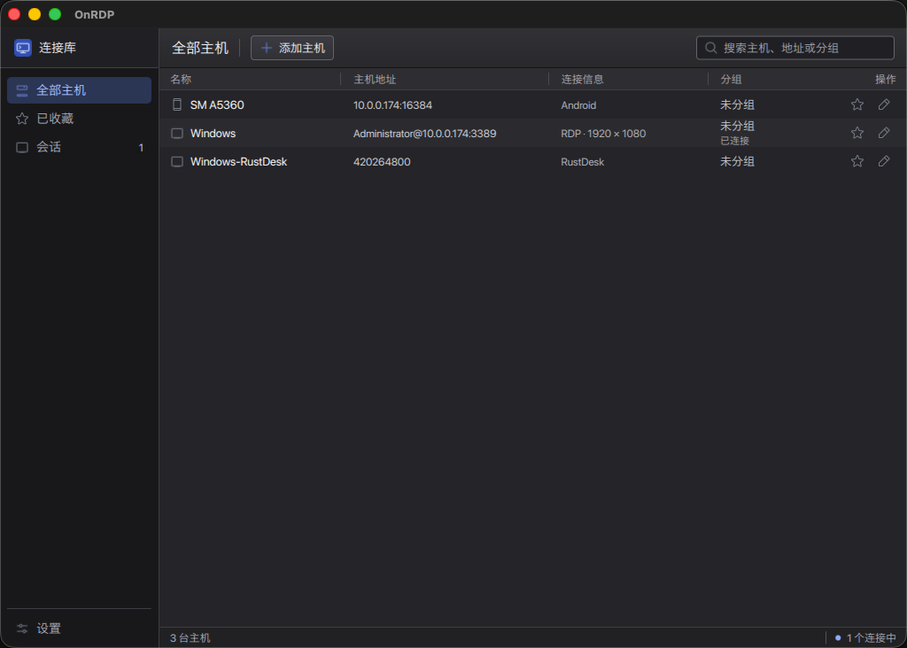

# OnRDP

[English](README.md) · **简体中文**

**原生远程桌面客户端 · 无 Electron · 无 WebView**

在 Windows、macOS 和 Linux 上集中管理 **RDP 远程桌面**、**RustDesk 连接**和 **Android 投屏与控制**。界面由 Onix 原生渲染，RDP 连接使用 FreeRDP。

**[下载 OnRDP](https://github.com/diiyw/onrdp/releases/latest)** · [安装说明](#安装) · [连接指南](#添加第一台主机)

如果 OnRDP 对你有用，欢迎点击仓库右上角的 **Star**。



## 安装

打开最新发行版，在 **Assets** 中选择你这台电脑对应的安装包。[GitHub Releases](https://github.com/diiyw/onrdp/releases/latest)

| 本机系统 | 安装包 | 安装方式 |
| --- | --- | --- |
| Windows 64 位 | `onrdp-windows-amd64-setup.exe` | 运行安装程序 |
| macOS Apple 芯片 | `OnRDP-macos-arm64.dmg` | 打开后将 OnRDP 拖到「应用程序」 |
| macOS Intel 芯片 | `OnRDP-macos-amd64.dmg` | 打开后将 OnRDP 拖到「应用程序」 |
| Ubuntu 24.04 / Linux Mint 22（64 位） | `onrdp-linux-amd64.deb` | 在下载目录运行下方的 APT 命令 |

```sh
sudo apt update
sudo apt install ./onrdp-linux-amd64.deb
```

发布页的 `SHA256SUMS` 可用于校验下载文件。macOS 安装包使用临时签名，尚未经过 Apple 公证。

如果所需平台的安装包尚未发布，可以登录 GitHub，在成功的工作流运行中查看 **Artifacts**。也可以从源码构建。[安装包构建记录](https://github.com/diiyw/onrdp/actions/workflows/build.yml) · [开发指南](docs/development.md)

## 添加第一台主机

1. 打开 OnRDP，在「全部主机」点击「添加主机」，选择 **RDP**、**RustDesk** 或 **Android**。
2. 填写一个便于识别的名称，再按下方对应的连接方式填写信息。分组可选。
3. 点击「保存」，回到主机列表，点击刚保存的主机打开连接。

### RDP 连接 Windows

1. 在被控电脑的「设置 → 系统 → 远程桌面」启用远程桌面，确认你的 Windows 账号有远程登录权限。Windows 家庭版不能作为 RDP 被控端。[Microsoft 远程桌面设置说明](https://learn.microsoft.com/windows-server/remote/remote-desktop-services/remotepc/remote-desktop-allow-access)
2. 在 OnRDP 的 **RDP** 表单中填写电脑的 IP 地址或域名，以及远程桌面的端口（默认 `3389`）。
3. 填写 Windows 用户名和登录密码。使用域账号时同时填写「域」。

RDP 使用 TLS 和网络级身份验证（NLA）。当前 OnRDP 会跳过服务端证书验证，请仅在受信任的网络中连接受信任的主机。

### RustDesk 连接远程设备

1. 在被控端打开 RustDesk，查看设备 ID 和密码。
2. 在 OnRDP 的 **RustDesk** 表单中填写设备 ID 和密码。被控端允许手动确认时，密码可以留空，由对方接受连接。
3. 若被控端已启用 IP 直连，可在同一字段填入 IP 地址或 `IP:端口`。

使用自建服务器时，在「ID 与中继服务器（可选）」填写 ID 服务器（`hbbs`，默认端口 `21116`）和 `id_ed25519.pub` 中的公钥。若需指定中继服务器（`hbbr`，默认端口 `21117`），在被控端 RustDesk 的「设置 → 网络」中也填写同一地址。填好 ID 服务器后，可点击「复制被控端配置」并到被控端导入。勾选「始终使用中继」可让该主机通过中继连接。[RustDesk 自建服务器配置说明](https://rustdesk.com/docs/en/self-host/client-configuration/)

RustDesk 当前支持单屏画面和键鼠操作，已在 Linux 上验证实际连接。macOS 和 Windows 的原生连接尚待验证。Apple 芯片上的 RustDesk 核心库需要 macOS 12.3 或更新版本。

### Android 投屏

**USB 连接**

1. 在 Android 设备的「开发者选项」中开启「USB 调试」，用数据线连接电脑，并在设备上允许调试。
2. 在 OnRDP 的 **Android** 表单中点击「刷新」，从「ADB 设备」列表选择设备，也可以在「设备序列号」中手动填写。

**无线连接（Android 11 或更新版本）**

1. 将电脑和 Android 设备连到同一个 Wi-Fi。在设备的「开发者选项」中开启「无线调试」，选择使用配对码配对。
2. 在电脑终端用 ADB 执行 `adb pair IP:配对端口`，按提示输入配对码。如果终端找不到 `adb`，可以安装 Android SDK Platform-Tools，并在其目录运行 ADB。[Android 无线调试说明](https://developer.android.com/tools/adb#connect-to-a-device-over-wi-fi)
3. 回到设备的「无线调试」主页，查看「IP 地址和端口」。在 OnRDP 选择「无线连接」，将这里显示的 **连接端口** 和 IP 一起填入「无线调试地址」。上一步的配对端口只用于配对。

## 使用主机列表和会话

- 在右上角按名称、地址或分组搜索。点击主机右侧的星标可收藏，点击铅笔可修改或删除主机。
- 桌面连接会在独立窗口中打开。可在主窗口继续打开其他连接，或在「会话」中查看和断开连接。关闭主窗口会结束所有会话。
- **RDP** 会话中，点击远程画面即可输入。悬浮工具条提供全屏、重连和 `Ctrl+Alt+Del`、`Alt+Tab` 等远程快捷键，也可按 `F11` 切换全屏。
- **Android** 投屏默认跟随当前激活的屏幕，可用工具条的「切换屏幕」固定某个屏幕。工具条还提供返回、主屏幕、最近任务、音量和电源键。将一个或多个 APK 拖进投屏窗口，可依次安装到该设备。Android 7.0 及以上版本可在支持粘贴的输入框中用电脑输入法输入中文和表情，音频保留在设备上。
- 在「设置」中可切换主题和界面语言，以及管理自动重连与剪贴板同步。主机和凭据保存在本机的加密凭据库中。

## 常见问题

| 问题 | 处理方法 |
| --- | --- |
| RDP 连不上 | 确认被控电脑已开启远程桌面、本机可访问其地址和端口，并检查账号、密码及远程登录权限。 |
| RDP 画面卡顿 | 在「编辑主机 → 显示与共享 → 画面质量」选择「流畅」，保存后重新连接。窗口模式下，「流畅」最高请求 `1280 × 720`，「均衡」最高请求 `1920 × 1080`，「高清」使用主机配置的尺寸。 |
| RDP 全屏分辨率与预期不同 | 全屏时 OnRDP 会按本机屏幕的实际像素请求远程分辨率。最终尺寸受服务端能力限制。若服务端未启用动态分辨率，会保留原有分辨率。 |
| 找不到 Android 设备 | USB 连接时，检查设备是否已允许调试，再点击「刷新」。无线连接时，确认已完成配对，并核对「无线调试」主页当前显示的 IP 和连接端口。 |

## 功能范围与开发

OnRDP 提供 Windows、macOS 和 Linux 桌面版。RDP 的音频、摄像头、驱动器、打印机、智能卡和 USB 重定向尚未接入。

源码运行、打包、硬件解码和原生依赖见开发指南。[开发指南](docs/development.md) · [第三方声明](THIRD_PARTY_NOTICES.md)
